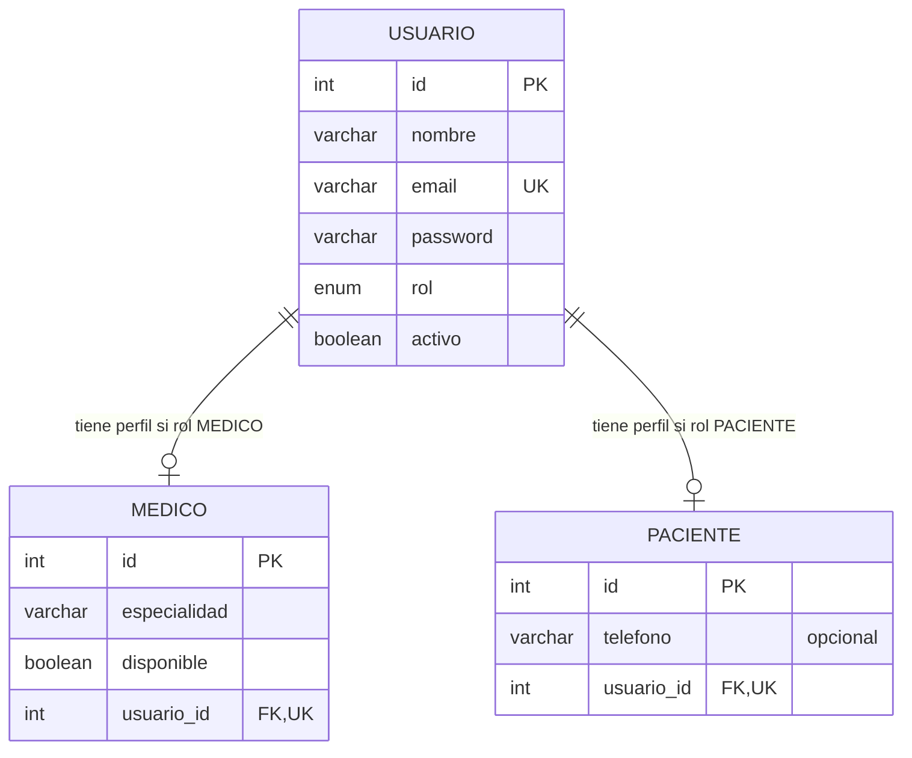

# Modelo entidad-relación

`Usuario` almacena los datos de identidad y autenticación; los perfiles no
duplican nombre, email ni contraseña. `usuario_id` es una FK única en ambos
perfiles y se valida que el rol del usuario coincida con su perfil. La
disponibilidad del médico es general, no una disponibilidad por fecha/hora.

**Cita está pendiente** y no forma parte de este diagrama ni de esta entrega.
