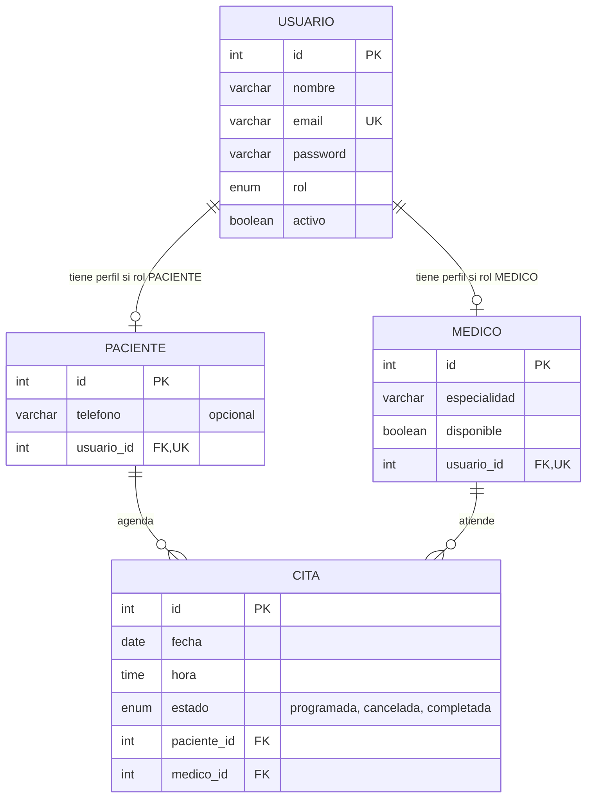

# Modelo entidad-relación

`Usuario` almacena los datos de identidad y autenticación; los perfiles no
duplican nombre, email ni contraseña. `usuario_id` es una FK única en ambos
perfiles y se valida que el rol del usuario coincida con su perfil. La
disponibilidad del médico es general, no una disponibilidad por fecha/hora.
Una cita pertenece a exactamente un paciente y un médico. El horario se
interpreta en la zona de negocio `America/Bogota`. Solo las citas `programada`
y `completada` ocupan el horario; cancelar una cita libera el turno para una
nueva reserva. El servicio serializa reservas y cancelaciones por médico con
bloqueo pesimista transaccional, no con una restricción única sobre fecha/hora.
